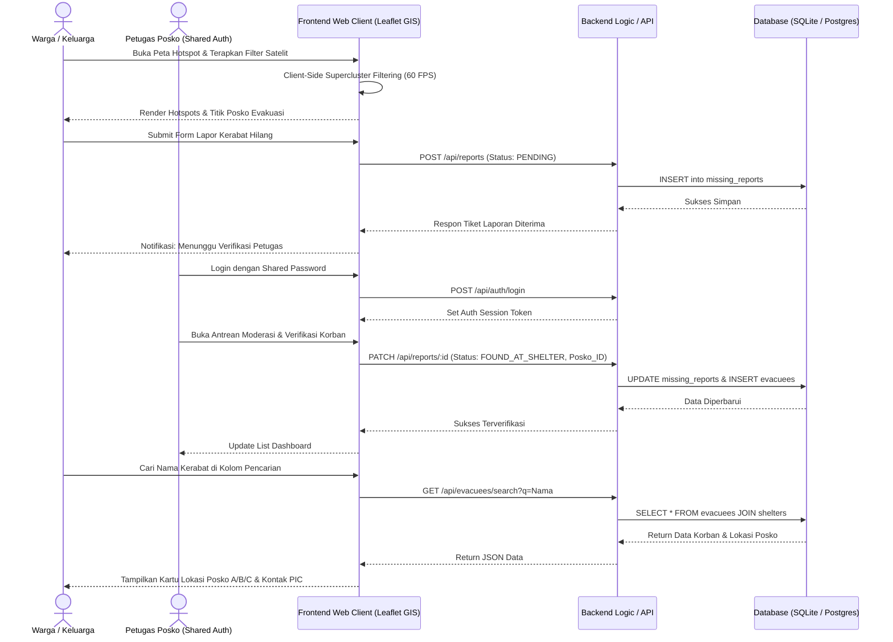
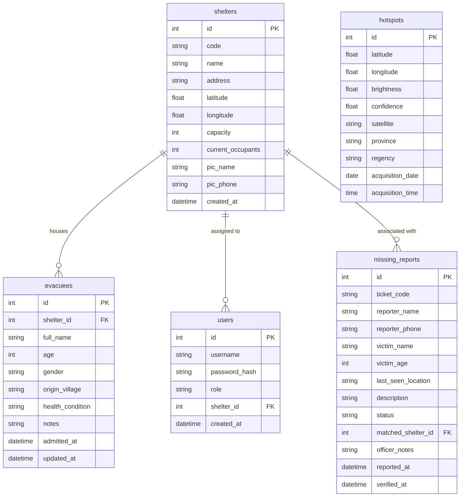

# 📄 PROJECT REQUIREMENTS DOCUMENT (PRD)

## 1. Overview

### 1.1 Project Overview
**SI-KARHUTLA (Sistem Informasi Karhutla & Manajemen Posko Evakuasi)** adalah platform web terpadu yang memadukan visualisasi spasial interaktif titik kebakaran hutan dan lahan (*hotspot geoportal*) berkinerja tinggi—mengacu pada standar data geoportal **BNPB 2026**—dengan sistem kemanusiaan tanggap darurat (*crisis response*) untuk pencarian korban hilang dan direktori posko pengungsian.

Platform ini hadir untuk menjembatani dua kebutuhan vital:
1. **Pemantauan Spasial & Edukasi Mitigasi Publik:** Menyajikan peta sebaran titik panas interaktif yang mulus (*smooth GIS mapping*) dengan filter satelit, tingkat kepercayaan (*confidence level*), visualisasi klaster (*clustering*), serta ensiklopedia mitigasi struktural dan non-struktural berbasis regulasi **UU No. 24 Tahun 2007**.
2. **Sistem Pelacakan Pengungsi & Reuni Keluarga (*Killer Feature*):** Menyediakan mekanisme pencarian korban dan lokasi posko evakuasi (Posko A, B, C) bagi keluarga yang terpisah akibat kebakaran hutan dan kehilangan akses komunikasi seluler, didukung oleh sistem verifikasi laporan satu pintu oleh petugas posko (*Moderator Approval*).

### 1.2 Problem Statement
- **Keterbatasan Akses & Performa Peta Bencana:** Geoportal pemantauan titik api yang ada sering kali berat (*laggy*), sulit diakses melalui perangkat seluler masyarakat di wilayah terdampak, dan tidak menyajikan konteks keselamatan publik secara langsung.
- **Kepanikan & Putus Kontak Pascabencana:** Kabut asap pekat (*smoke haze*) dan kobaran api sering memutus infrastruktur kelistrikan dan BTS seluler. Warga mengungsi secara tergesa-gesa tanpa ponsel, menyebabkan keluarga terpisah tanpa mengetahui kerabat mereka dievakuasi ke posko mana dan bagaimana kondisi fisiknya.
- **Risiko Misinformasi Data Orang Hilang:** Laporan orang hilang yang disebarkan secara liar di media sosial sering kali menimbulkan kepanikan dan hoaks. Dibutuhkan alur moderasi di mana laporan masyarakat diverifikasi secara valid oleh petugas posko sebelum dipublikasikan.

### 1.3 User Personas
1. **Keluarga Korban / Masyarakat Publik (End-User):**
   - *Kebutuhan:* Memantau wilayah rawan kebakaran di sekitarnya, mencari nama kerabat di daftar posko evakuasi, dan mengirimkan laporan orang hilang jika kerabat belum ditemukan.
2. **Petugas Lapangan / Relawan Posko (Authorized Operator - Single Shared Admin):**
   - *Kebutuhan:* Masuk ke sistem dengan autentikasi cepat (*shared password*) untuk mencatat korban yang tiba di posko, memperbarui status kesehatan pengungsi, serta memvalidasi laporan orang hilang dari warga.
3. **Masyarakat Umum & Akademisi (Edukasi & Advokasi):**
   - *Kebutuhan:* Mengakses data edukasi mitigasi struktural (*rewetting*, sekat bakar, embung air) dan memahami sanksi hukum pembakaran lahan (*strict liability*).

---

## 2. Requirements

Berikut adalah spesifikasi persyaratan sistem tingkat tinggi:

### 2.1 Functional Requirements (FR)
- **FR-01 (Smooth Interactive Hotspot Map):** Peta GIS berbasis vektor/kanvas dengan performa mulus (*60 FPS pan & zoom*), mendukung *dynamic marker clustering*, *heatmap toggle*, filter sensor satelit (**NASA-TERRA/AQUA**, **NASA-NOAA20**, **VIIRS**), filter rentang waktu berkala (arsip historis bulanan berbasis data BNPB 2026), dan filter provinsi prioritas (Riau, Jambi, Sumsel, Kalbar, Kalteng, Kalsel).
- **FR-02 (Shelter Spatial Layer):** Peta menampilkan layer lokasi posko evakuasi aktif (Posko A, B, C) lengkap dengan indikator kapasitas tampung, status keterisian, dan jarak relatif dari radius titik api aktif.
- **FR-03 (Mitigation & Knowledge Hub):** Halaman edukasi interaktif menyajikan definisi, perbandingan penyebab (alami vulkanik/petir vs manusia/flare/sawit), dampak ganda (krisis ISPA vs ekologi *serotiny*), mitigasi fisik struktural (*canal blocking/rewetting*, embung air, sekat bakar *firebreak*), dan mitigasi non-struktural (Pasal 40, Pasal 75–79 **UU No. 24 Tahun 2007**).
- **FR-04 (Public Evacuee Search Engine):** Kolom pencarian cepat berbasis nama korban atau alamat asal yang menampilkan hasil instan mengenai status keberadaan korban, nama posko tempat ditampung, kondisi kesehatan, dan kontak PIC posko.
- **FR-05 (Public Missing Person Submission):** Formulir pengajuan pelaporan orang hilang oleh masyarakat. Setiap pengajuan secara *default* berstatus `PENDING_VERIFICATION` dan tidak ditayangkan langsung ke publik.
- **FR-06 (Single Shared Admin Authentication):** Halaman login petugas posko yang diamankan dengan *shared access credential* tanpa hierarki multi-level yang rumit untuk mempermudah mobilitas relawan lapangan.
- **FR-07 (Officer Moderation & Shelter Registry):** Panel petugas untuk mencatat pengungsi baru yang tiba di posko, memperbarui kondisi medis penyintas (*Sehat, Luka Ringan, Perawatan Intensif*), serta memverifikasi antrean laporan hilang menjadi status `VERIFIED` atau `FOUND_AT_SHELTER`.

### 2.2 Non-Functional Requirements (NFR)
- **NFR-01 (Rendering Performance & Smoothness):** Peta interaktif wajib mempertahankan *rendering rate* stabil di **60 FPS** saat melakukan navigasi *pan* dan *zoom* pada minimal 2.000 titik *hotspot* dengan menerapkan *client-side spatial indexing* (*Supercluster / Canvas layer*).
- **NFR-02 (Low Bandwidth & Mobile Optimization):** Halaman depan dan pencarian korban harus memiliki waktu muat awal (*First Contentful Paint*) di bawah **1.5 detik** pada jaringan 3G rendah, dengan ukuran *bundle payload* peta yang terkompresi.
- **NFR-03 (Data Ingestion Boundary):** Menggunakan data *snapshot batch* berkala (arsip terkurasi dari dataset BNPB 2026) yang disimpan secara lokal/ringan dalam format GeoJSON teroptimasi, sehingga sistem tidak bergantung pada *live streaming API* eksternal yang rentan putus saat bencana.
- **NFR-04 (Data Integrity & Verification Gate):** Seluruh data laporan orang hilang dari masyarakat wajib melewati *moderation gate* oleh petugas posko guna menjamin validitas informasi dan mencegah hoaks di ruang publik.

---

## 3. Core Features

### 3.1 Feature Specification (MoSCoW Matrix)

| Kategori | Nama Fitur | Deskripsi Fungsional |
| :--- | :--- | :--- |
| **Must Have (MVP)** | **Peta Hotspot Interaktif Smooth GIS** | Visualisasi titik api interaktif berbasis referensi BNPB 2026 dengan *marker clustering*, *filtering* satelit & tingkat kepercayaan, serta navigasi bebas *lag*. |
| **Must Have (MVP)** | **Pencarian Korban & Direktori Posko** | Mesin pencari publik untuk menemukan nama anggota keluarga yang dievakuasi di Posko A, B, atau C beserta kondisi medis dan kontak posko. |
| **Must Have (MVP)** | **Form Lapor Mandiri Orang Hilang** | Formulir warga untuk mendaftarkan kerabat hilang dengan status awal masuk ke antrean `PENDING_VERIFICATION`. |
| **Must Have (MVP)** | **Portal Petugas (Single Shared Auth)** | Akses terproteksi bagi petugas lapangan untuk mencatat korban masuk dan memoderasi laporan masuk warga. |
| **Must Have (MVP)** | **Direktori Mitigasi & Regulasi Karhutla** | Katalog interaktif memuat mitigasi struktural (*rewetting*, sekat bakar) dan penegakan hukum UU 24/2007. |
| **Should Have** | **Layer Spasial Posko Terpadu** | Penanda titik lokasi posko evakuasi langsung di atas peta sebaran kebakaran hutan. |
| **Should Have** | **Statistik Ringkasan Bencana BNPB Style** | *Widget* metrik ringkas: Total Hotspot Aktif, Total Pengungsi Selamat, dan Estimasi Luas Area Terdampak. |
| **Could Have** | **Ekspor Manifes Posko (CSV / Print-Ready)** | Kemampuan petugas mengunduh daftar manifes pengungsi posko harian untuk koordinasi logistik. |
| **Won't Have (Fase 1)**| **Live Tracking GPS Regu Pemadam** | Pemantauan posisi armada pemadam darat secara *real-time* via GPS (ditunda ke fase lanjutan). |
| **Won't Have (Fase 1)**| **Live API Streaming Satelit 24/7** | Penarikan data satelit NASA/LAPAN otomatis per menit (menggunakan kurasi data berkala BNPB). |

---

### 3.2 Detailed Requirements & Acceptance Criteria (Gherkin Format)

#### Fitur 1: Eksplorasi Peta Titik Api Interaktif (Smooth GIS)
* **User Story:** Sebagai masyarakat, saya ingin menjelajahi peta sebaran kebakaran hutan dengan interaksi yang mulus dan filter yang fleksibel agar saya mengetahui area rawan di sekitar wilayah saya.
* **Acceptance Criteria:**
  ```gherkin
  Scenario: Pengguna memfilter titik api berdasarkan sensor satelit dan tingkat kepercayaan
    Given pengguna berada di antarmuka "Peta Sebaran Karhutla"
    When pengguna memilih filter satelit "NASA-NOAA20"
    And pengguna memilih tingkat kepercayaan "Tinggi (>80%)"
    Then peta memperbarui tampilan titik api dalam waktu kurang dari 200 ms tanpa reload halaman
    And titik-titik api dikelompokkan secara visual menggunakan cluster dinamis
    And saat pengguna melakukan zoom in, cluster terpecah secara halus menjadi pin koordinat spesifik
    And saat pin diklik, muncul popup rincian: Satelit, Tanggal/Jam Deteksi, Koordinat, dan Kabupaten/Provinsi
  ```

#### Fitur 2: Pencarian Korban di Posko Pengungsian (Publik)
* **User Story:** Sebagai anggota keluarga korban karhutla, saya ingin mencari nama anggota keluarga saya di kolom pencarian agar mengetahui lokasi penampungan posko mereka.
* **Acceptance Criteria:**
  ```gherkin
  Scenario: Pencarian nama korban yang sudah tercatat di posko evakuasi
    Given pengguna membuka tab "Cari Kerabat / Posko"
    When pengguna mengetikkan nama "Farel Silalahi" pada kotak pencarian
    Then sistem menampilkan kartu informasi korban yang memuat:
      | Nama Lengkap      | Farel Silalahi             |
      | Lokasi Pengungsian| Posko A - Balai Desa Harapan|
      | Kondisi Kesehatan | Sehat (Kelelahan Ringan)   |
      | Kontak PIC Posko  | 0812-XXXX-XXXX             |
    And sistem menyediakan tautan "Lihat Lokasi Posko di Peta"

  Scenario: Pencarian nama korban yang belum terdaftar di sistem
    Given pengguna melakukan pencarian dengan nama yang tidak terdapat di database posko
    When tombol pencarian dieksekusi
    Then sistem menampilkan status "Data Belum Ditemukan di Posko Pengungsian"
    And menampilkan tombol call-to-action "Ajukan Laporan Orang Hilang"
  ```

#### Fitur 3: Pengajuan Laporan Orang Hilang & Moderasi Petugas
* **User Story:** Sebagai pelapor, saya ingin mengajukan data anggota keluarga yang hilang, dan sebagai petugas posko, saya ingin memverifikasi laporan tersebut agar data yang tayang terjamin valid.
* **Acceptance Criteria:**
  ```gherkin
  Scenario: Pengajuan laporan orang hilang oleh warga
    Given pengguna mengisi formulir "Lapor Orang Hilang" dengan data lengkap
    When pengguna menekan tombol "Kirim Laporan"
    Then data tersimpan di database dengan status "PENDING_VERIFICATION"
    And pengguna menerima kode tiket pelaporan
    And nama korban TIDAK langsung muncul pada hasil pencarian publik

  Scenario: Petugas memverifikasi laporan orang hilang yang telah ditemukan di posko
    Given petugas posko telah masuk melalui autentikasi kredensial bersama (Shared Password)
    And petugas membuka panel "Antrean Verifikasi Laporan"
    When petugas memilih laporan dengan nama korban terkait
    And petugas mengubah status menjadi "FOUND_AT_SHELTER" serta menetapkan "Posko B"
    Then status laporan diperbarui di database
    And data korban secara instan dapat dicari oleh publik dengan status berada di Posko B
  ```

---

## 4. User Flow

Berikut adalah alur operasional pengguna publik dan petugas lapangan:

1. **Alur Eksplorasi Peta & Edukasi (Publik):**
   - Pengguna mengakses halaman utama platform SI-KARHUTLA.
   - Pengguna berinteraksi dengan Peta Spasial (melakukan *zoom, pan, cluster inspection*, dan menyaring data berdasarkan satelit atau provinsi).
   - Pengguna dapat beralih ke Modul Mitigasi untuk membaca panduan penanganan struktural (*rewetting*, sekat bakar) dan regulasi sanksi hukum kebakaran lahan.

2. **Alur Pelacakan Korban & Pelaporan Kehilangan (Publik):**
   - Pengguna membuka menu "Cari Korban".
   - Pengguna mengetik nama kerabat yang dicari.
   - *Kasus A (Ditemukan):* Sistem menampilkan kartu posko evakuasi (Posko A/B/C), kondisi fisik, dan kontak penanggung jawab posko.
   - *Kasus B (Tidak Ditemukan):* Sistem mengarahkan pengguna ke formulir "Lapor Orang Hilang". Pengguna mengisi identitas kerabat dan kontak pelapor. Laporan masuk ke status antrean `PENDING_VERIFICATION`.

3. **Alur Manajemen Posko & Moderasi Data (Petugas Lapangan):**
   - Petugas mengakses halaman login `/petugas` dan memasukkan *shared password* posko.
   - **Tindakan A (Registrasi Korban Baru):** Petugas menginput data warga yang baru saja tiba di posko evakuasi (Nama, Usia, Alamat Asal, Kondisi Medis). Data langsung berstatus aktif di direktori posko.
   - **Tindakan B (Moderasi Laporan Warga):** Petugas memeriksa antrean laporan orang hilang, mencocokkan dengan manifes lapangan, lalu mengubah status menjadi `FOUND_AT_SHELTER` atau menolaknya jika terindikasi duplikasi/data tidak valid.

---

## 5. Architecture

Sistem dirancang menggunakan arsitektur web modern yang ringan (*Jamstack / Lightweight Monolith*) untuk menjamin performa tinggi, ketergantungan minimal, dan kecepatan rendering peta GIS.



### Komponen Arsitektur Sistem:
1. **Frontend Presentation Layer:** 
   - Antarmuka berbasis komponen web responsif didukung **Tailwind CSS**.
   - Mesin visualisasi peta menggunakan **Leaflet.js** yang diperkuat modul **Supercluster / Canvas Renderer** untuk menjamin navigasi 60 FPS saat memproses ribuan titik panas tanpa membebani memori browser gawai warga.
2. **Backend Application Layer:**
   - Logika aplikasi ringan berbasis RESTful endpoint untuk menangani pencarian cepat (*full-text query*), pengiriman laporan, dan validasi sesi petugas.
3. **Data Persistence Layer:**
   - Database relasional terstruktur untuk integritas relasi antara data posko pengungsian, pengungsi, dan tiket laporan orang hilang. Data spasial titik api diakomodasi melalui format GeoJSON snapshot terindeks.

---

## 6. Database Schema

Berikut adalah Entity Relationship Diagram (ERD) yang merepresentasikan struktur data sistem:



### Rincian Tabel Database:

| Nama Tabel | Fungsi & Deskripsi Data |
| :--- | :--- |
| **`shelters`** | Menyimpan master data posko evakuasi (Posko A, B, C), koordinat lokasi, batas kapasitas, jumlah penampungan saat ini, serta nama dan kontak penanggung jawab (PIC). |
| **`evacuees`** | Menyimpan data seluruh korban selamat yang berada di dalam posko pengungsian, mencakup identitas, kondisi fisik/medis, dan tanggal masuk penampungan. |
| **`missing_reports`** | Menyimpan tiket laporan orang hilang yang dikirimkan warga. Memiliki status operasional: `PENDING_VERIFICATION`, `VERIFIED_MISSING`, `FOUND_AT_SHELTER`, atau `REJECTED`. |
| **`hotspots`** | Menyimpan katalog arsip titik panas (berdasarkan data BNPB 2026), memuat koordinat spasial (*latitude/longitude*), tingkat kepercayaan, sensor satelit, tanggal deteksi, dan wilayah administrasi. |
| **`users`** | Menyimpan kredensial petugas posko (*single admin / shared credentials*) untuk membatasi akses pada modul moderasi dan registrasi pengungsi. |

---

## 7. Design & Technical Constraints

### 7.1 High-Level Technology Constraints
1. **Arsitektur Tanpa Dependensi Live Satelit Kompleks:**
   - Sistem wajib menggunakan data *snapshot snapshot* terkurasi (GeoJSON) dari rujukan data BNPB 2026. Penarikan data satelit secara *real-time* ditiadakan untuk mencegah *single-point-of-failure* dan lonjakan biaya infrastruktur API.
2. **Kinerja Peta Interaktif (60 FPS Mandate):**
   - Komponen peta wajib menggunakan teknik *Canvas-rendered markers* atau *Web Worker clustering* (seperti `Leaflet.markercluster` atau `Supercluster`).
   - Dilarang merender ribuan elemen *DOM/SVG nodes* individual secara langsung yang dapat menyebabkan *browser throttling* atau *lag* pada ponsel berspesifikasi rendah.
3. **Mekanisme Shared Auth Sederhana:**
   - Menggunakan mekanisme sesi berbasis token/kuki sederhana dengan satu kata sandi bersama (*shared password*) per posko untuk mempercepat *login* relawan lapangan di posko darurat tanpa memerlukan registrasi akun yang rumit.

### 7.2 Typography & UI Rules
Antarmuka pengguna (UI) wajib menerapkan konfigurasi tipografi variabel terstandar berikut untuk menjamin keterbacaan teknis dan konsistensi visual:
- **Sans-serif:** `Geist Mono, ui-monospace, monospace`
- **Serif:** `serif`
- **Monospace:** `JetBrains Mono, monospace`

### 7.3 Data Privacy & Crisis Security
- Nomor kontak pelapor warga dan informasi medis mendalam hanya dapat diakses oleh petugas posko terotentikasi.
- Tampilan publik pada kartu pencarian korban hanya menampilkan: Nama Lengkap, Inisial/Usia, Nama Posko Evakuasi, Status Umum Kondisi Medis, dan Nomor Hotline Posko Resmi.