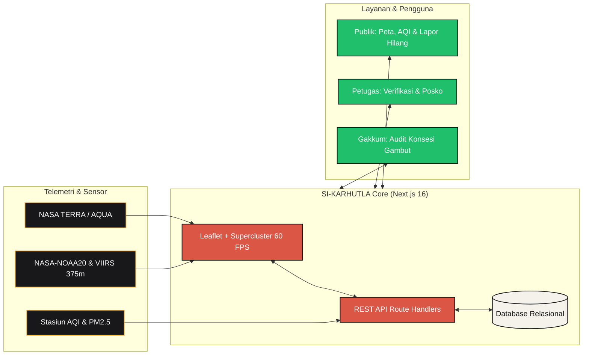

# 🔥 SI-KARHUTLA CLOUD (2026)
### Geoportal Spasial Titik Panas, Indeks AQI, Direktori Posko & Portal Kedaruratan Karhutla

 

  
  

> **Project Based Build — Tugas Besar Kelompok 6**  
> Mata Kuliah: **Sistem Informasi Manajemen Bencana (SIMB)**  
> Dosen Pengampu: **Herry Sofyan, S.T., M.Kom.**  
> Program Studi Sistem Informasi • Fakultas Teknik Industri  
> **Universitas Pembangunan Nasional "Veteran" Yogyakarta** • 2026

---

## 👥 Anggota Kelompok 6

| No | Nama Lengkap | NIM |
| :---: | :--- | :---: |
| **01** | Farel Paul Jhogi Silalahi | `124250132` |
| **02** | Muammar Ghazy Syafrudin | `124250133` |
| **03** | Bintang Fergiawan | `124250143` |
| **04** | Makfiy Ahmad Hamizan | `124250145` |

---

## 🌐 Arsitektur Sistem Kedaruratan

---

## ✨ Fitur-Fitur Utama Platform

<b>🔥 1. Geoportal Spasial Titik Panas (Hotspot GIS 60 FPS)</b>

 

- **Mesin Spasial Cepat:** Didukung algoritma *Supercluster Canvas* yang mampu merender ribuan titik anomali termal NASA & NOAA tanpa lag.
- **Filter Multi-Kriteria:** Filter interaktif berdasarkan jenis sensor satelit, provinsi prioritas (*Riau, Jambi, Sumsel, Kalbar, Kalteng, Kalsel*), dan tingkat kepercayaan (*confidence* ≥ 80%).
- **Layer Posko Terpadu:** Menampilkan sebaran posko evakuasi dengan pin pelindung interaktif dan detail kapasitas.

<b>🛡️ 2. Direktori Posko & Reuni Keluarga Pengungsi</b>

 

- **Live Capacity Bar:** Indikator persentase keterisian posko evakuasi (Posko A Rimbo Panjang, Posko B Minas Jaya, Posko C Danau Bingkuang).
- **Pencarian Kerabat Instan:** Fasilitas pencarian data warga terevakuasi, kondisi kesehatan medis (*Sehat, Kelelahan, ISPA Ringan, ISPA Berat, Perawatan Intensif*), asal desa, dan kontak darurat PIC resmi posko.

<b>🎫 3. Tiket Pengaduan Publik Mandiri (`/lapor`)</b>

 

- **Formulir Laporan Terbuka:** Masyarakat dapat menerbitkan laporan orang hilang akibat karhutla secara cepat.
- **Kode Tiket Instan:** Setiap laporan menghasilkan kode unik (contoh: `LAPOR-2026-9812`) untuk memudahkan pelacakan status tanpa perlu login.

<b>🔐 4. Portal Petugas Verifikator Lapangan (`/petugas`)</b>

 

- **Autentikasi Terproteksi:** Portal khusus bagi petugas BNPB dan Satgas Posko.
- **Pencocokan Otomatis (*Matching Engine*):** Memverifikasi aduan korban hilang langsung ke daftar manifes pengungsi posko dengan status: `PENDING_VERIFICATION`, `VERIFIED_MISSING`, atau `FOUND_AT_SHELTER`.

<b>🌬️ 5. Telemetri Kualitas Udara (Indeks US EPA AQI & PM2.5)</b>

 

- **Pemantauan Real-Time:** Stasiun pemantau AQI dari Pekanbaru, Palembang, Jambi, Pontianak, Palangka Raya, hingga Banjarmasin.
- **Panduan Medis Tanggap Bencana:** Kategori bahaya kualitas udara (*Baik, Sedang, Tidak Sehat, Berbahaya*) lengkap dengan protokol masker respirator N95/P100 dan evakuasi balita/lansia.

<b>📜 6. Ensiklopedia Mitigasi Karhutla & Audit Konsesi Korporasi</b>

 

- **Pustaka Mitigasi Kebencanaan:** Panduan regulasi UU No. 24 Tahun 2007, studi ilmiah siklus ekologis gambut, dan mitigasi sekat kanal (*canal blocking*).
- **Transparansi Konsesi:** Pemantauan titik panas pada konsesi perkebunan kelapa sawit dan HTI dengan penegakan asas pertanggungjawaban mutlak (*strict liability*).

---

## 🛠️ Stack Teknologi

| Komponen | Teknologi | Keterangan |
| :--- | :--- | :--- |
| **Framework** | Next.js 16 (App Router) | High-performance fullstack framework dengan Turbopack |
| **Language** | TypeScript 5.8 | Strict type-safety untuk entitas kebencanaan |
| **User Interface** | React 19 + Tailwind CSS | Desain *Swiss Editorial Broadsheet* bebas distraksi |
| **Motion Engine** | Framer Motion 14 | Animasi *scroll-driven*, *parallax*, dan *tactile hover* |
| **GIS & Mapping** | Leaflet 1.9 + Supercluster | Peta interaktif OpenStreetMap bebas watermark |
| **Icons & Typography** | Lucide React + PP Right Grotesk | Tipografi berkarakter editorial jurnalistik |
| **Storage & API** | Next.js Route Handlers + JSON DB | RESTful Endpoints (`/api/*`) dengan schema validation |

---

## 🔌 Dokumentasi REST API

| Method | Endpoint | Deskripsi Fungsi |
| :---: | :--- | :--- |
| `GET` | `/api/hotspots` | Mengambil seluruh titik panas satelit aktif NASA/NOAA |
| `GET` | `/api/shelters` | Mengambil daftar posko evakuasi & kapasitas terkini |
| `GET` | `/api/evacuees` | Mengambil data penyintas/korban yang dievakuasi di posko |
| `GET` | `/api/reports` | Mengambil daftar tiket laporan orang hilang |
| `POST` | `/api/reports` | Mengirimkan laporan pengaduan korban hilang baru |
| `PATCH` | `/api/reports/[id]` | Memperbarui status verifikasi laporan oleh petugas posko |
| `GET` | `/api/aqi` | Mengambil indeks kualitas udara US EPA AQI & PM2.5 |
| `GET` | `/api/concessions`| Mengambil data konsesi korporasi & anomali titik api |
| `POST` | `/api/auth` | Verifikasi kredensial akses Portal Petugas Lapangan |

---

**SI-KARHUTLA Cloud (2026)**  
*Project Based Build By Kelompok 6 SIMB UPN "Veteran" Yogyakarta*  
Standardisasi BNPB 2026 • Rujukan UU No. 24 Tahun 2007

